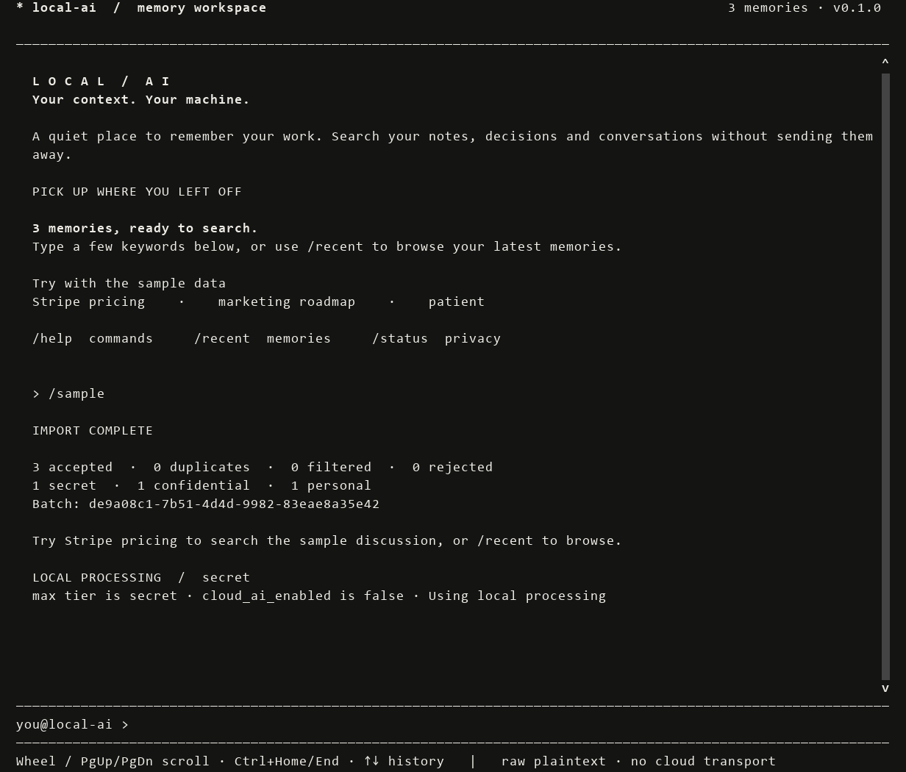
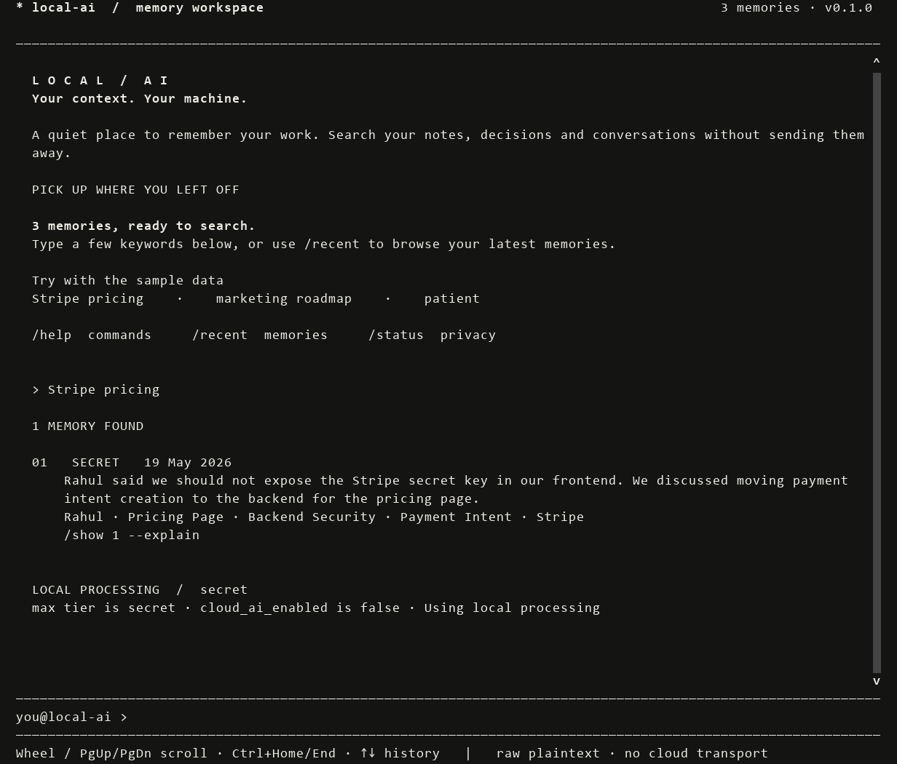
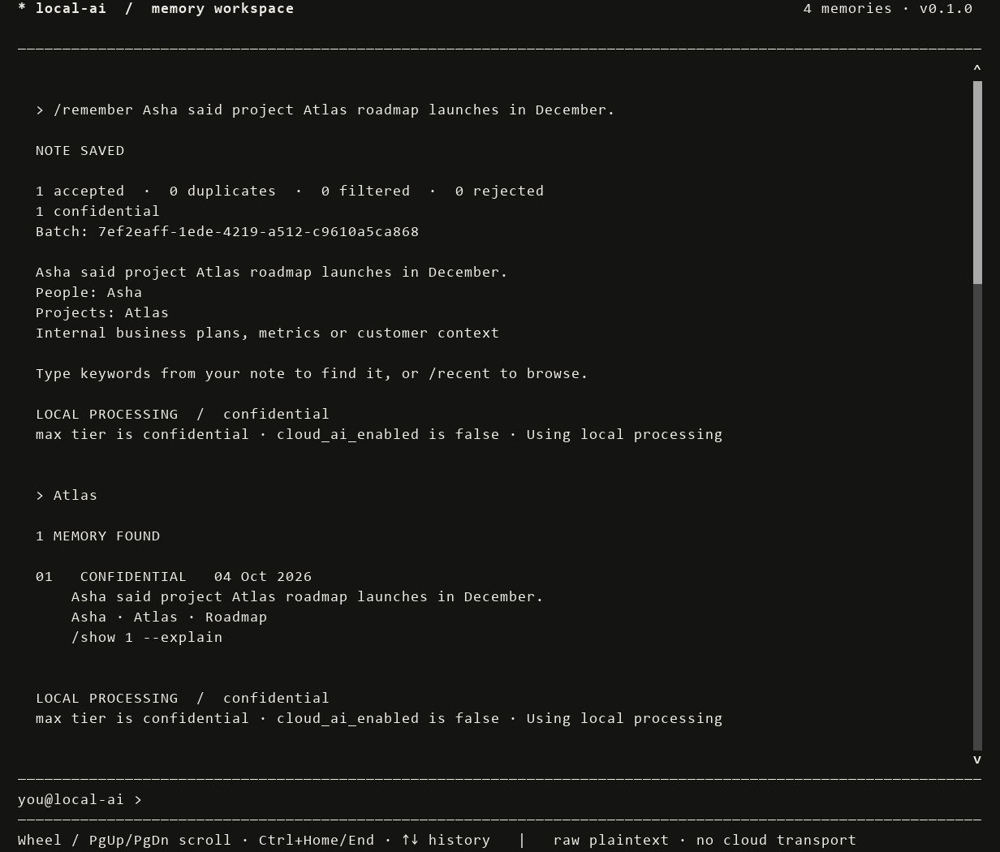

# Privacy-First Local AI CLI Assistant

A Python prototype that saves workstation events locally, extracts structured memories, classifies their privacy sensitivity, and lets you search them from a terminal. Every ingestion/search produces an explainable routing verdict. **No data is sent to a cloud AI service.**

Want only the commands? Open the [simple command guide](COMMANDS.md).

## Install and run

Requires **Python 3.11+** with SQLite FTS5 support (included in standard Python distributions).

### Windows: easiest way

1. Clone this repository and open its folder. If Python is missing, install it with **Add Python to PATH** enabled.
2. Double-click [START.bat](START.bat) (located in the repository root).
3. The launcher creates `.venv` and installs the terminal UI and encryption dependencies if needed. Internet is needed for initial installation; no activation or launch command is needed on later runs.
4. If the app says **setup needed**, enter this once:

```text
/init --encryption passphrase
```

Choose and repeat a passphrase of at least 12 characters. The app prompts inside a masked dialog. Existing storage does not need initialization again. Each save currently asks for the passphrase because the app does not keep an unlocked key between commands.

### Manual installation: Windows, macOS, Linux

Run from the repository folder:

```sh
python -m venv .venv
```

Activate on Windows PowerShell:

```powershell
.venv\Scripts\Activate.ps1
```

Or on macOS/Linux:

```sh
source .venv/bin/activate
```

Then install and launch:

```sh
python -m pip install -e ".[ui,crypto]"
local-ai shell
```

Use `local-ai shell --plain` for a basic line interface. `python scripts/local-ai.py shell` also runs from source. The core uses Python's standard library; `ui` adds prompt-toolkit, and `crypto` adds cryptography/keyring. No model download, database server, GPU, or cloud API key is required.

## Try the prototype

Inside the app, enter these one at a time after initialization:

```text
/sample
/recent
Stripe pricing
/show 1 --explain
/remember Asha said project Atlas roadmap launches in December.
Atlas
```

Expected outcomes:

- `/sample` imports the three assignment events. Repeating it reports duplicates.
- `Stripe pricing` returns the Stripe discussion, classified **secret**, including Rahul, Pricing Page, and related topics.
- `/show 1 --explain` explains the first result's classification using rule evidence without exposing detected credential values.
- `/remember ...` reports **NOTE SAVED**. Searching `Atlas` returns that **confidential** business note.
- Routing remains `local_ai` under the default policy.

To import your own JSON file, use `/ingest "C:\path\events.json"`. The [sample file](src/local_ai/data/mock_events.json) shows the required `type`, `app`, `source`, `content`, and UTC `timestamp` fields. `/remember` creates a note event for you.

### Standalone ingestion and search commands

These are regular terminal commands, outside the interactive app. Use a new `.demo` directory for this example; skip `init` if already initialized:

```sh
local-ai --data-dir .demo init --encryption passphrase
local-ai --data-dir .demo ingest src/local_ai/data/mock_events.json
local-ai --data-dir .demo search "Stripe pricing" --json
local-ai --data-dir .demo route --query "Stripe pricing" --mode cloud_required
```

The last command returns `blocked` with exit code 3 because cloud use is disabled. For synthetic-only plaintext testing, use `init --no-encryption` in a new directory. That option does not encrypt raw records.

## Sample walkthrough in pictures

These images are rendered from the actual terminal interface using only the bundled synthetic events in a disposable **plaintext demo** workspace. They do not show private user data. For your own notes, use encrypted setup as described above. IDs and counts depend on your workspace.

### 1. Import sample data

Inside the app:

```text
/sample
```

Expected in a fresh workspace: **3 accepted**, with secret, confidential and personal classifications. Equivalent file command: `/ingest "src/local_ai/data/mock_events.json"` when launched from this repository.



### 2. Search and inspect a result

```text
Stripe pricing
/show 1 --explain
```

The image shows the search result: Rahul, Pricing Page, related topics, a **secret** classification and local routing. The second command opens the detailed rule explanation.



### 3. Add and find a new note

```text
/remember Asha said project Atlas roadmap launches in December.
Atlas
```

Enter your passphrase if prompted. The note is saved and the search returns a **confidential** business memory.



## Commands and storage

| In-app command | What it does |
|---|---|
| `/recent` | List saved memories and their full IDs |
| `/show 1 --explain` | Inspect result 1 from the latest listing/search |
| `/status`, `/doctor` | Storage overview and integrity/permission checks |
| `/forget --id ID` | Delete one memory and its source raw event |
| `/forget --all` | Delete all memories/raw events; retain setup and audits |
| `/forget --last 2h` | Delete events timestamped within the last two hours |
| `/forget --since 2026-05-19T10:00:00Z --until 2026-05-19T12:00:00Z` | Delete a custom event-time range |
| `/maintain` | Apply raw/audit retention and compact storage |
| `/reset` | Delete application state and encryption key; close the app |
| `/clear` | Clear the displayed transcript, not saved memories |
| `/help`, `/exit` | Help or close the app |

Deletion prompts require typing `DELETE`. Reset requires initialization on the next launch. Deletion does not remove already displayed text; `/clear` clears the current transcript.

Mouse wheel or PgUp/PgDn scrolls output; Ctrl+Home/End jumps to oldest/latest output. Up/Down recalls commands, Tab completes them, and Esc cancels a dialog. Transcript/history are temporary, bounded, and not saved to a history file.

Default storage is `%LOCALAPPDATA%\local-ai` on Windows and `$XDG_DATA_HOME/local-ai` (or `~/.local/share/local-ai`) on macOS/Linux. `--data-dir` selects another dedicated directory. The Windows launcher opens default storage without importing examples or deleting anything.

## Assignment capabilities

| Required capability | Implemented approach |
|---|---|
| 1. Ingest mock events | JSON object/array or CLI stdin; supports transcript, note, shell_history, browser_metadata, clipboard. Validates fields, sizes and timestamps; applies capture filters and deduplication. |
| 2. Extract structured memories | Returns people, projects, topics, summary and sensitivity. Default extraction uses rules over redacted text; summaries retain up to two sentences. An optional local model can enhance extraction. |
| 3. Classify privacy with explanations | Highest matching tier wins: secret > confidential > personal > public. Returns tier, confidence and structured rule evidence. Unknown context defaults to personal. |
| 4. Persist locally | Separate SQLite raw, memory/search and audit files. Raw envelopes are encrypted unless explicitly opted out; searchable memories are redacted plaintext. |
| 5. Search from CLI | FTS5 keyword search with stemming, AND matching and BM25 ranking. No embeddings or remote search service. |
| 6. Make a local-first routing decision | Returns JSON with `path`, `max_tier`, evaluated settings, reasons and redaction count. Paths are `local_ai`, `cloud_ai`, or `blocked`. |

| Privacy tier | Examples |
|---|---|
| secret | Credentials, API tokens, private keys, database passwords; credential mentions are conservatively sensitive too |
| confidential | Proprietary business details, financial metrics, internal roadmaps |
| personal | Private conversations, health context, identity data, unknown context |
| public | Explicitly allowlisted public reference material without higher-tier evidence |

The supplied Stripe, roadmap and medical events classify as **secret**, **confidential** and **personal**, respectively. Extraction is a deterministic approximation, not general-purpose semantic understanding.

## Why this architecture?

```text
Untrusted JSON / typed note
    -> validate and filter -> sanitize and classify locally
    -> extract from redacted text -> recheck derived fields -> routing verdict
    -> atomic writes: encrypted raw.db + redacted memories.db + audit.db

Search -> memories.db only -> classify query + result tiers -> routing verdict
```

| Decision | Reason and trade-off |
|---|---|
| Python with standard-library core | Easy to run and inspect; dependencies are optional except when enabling UI/encryption. |
| Separate raw, memory and audit databases | Search does not open raw content. Each data class has a clear purpose and retention policy. Separate files are not a sandbox against a compromised same-user process. |
| SQLite with FTS5 | No server, indexed local search, relational cleanup and transactions. Keyword search is lightweight but cannot understand every paraphrase. |
| Local deterministic privacy rules | Decisions are repeatable and explainable before any potential network boundary. Rules can miss unfamiliar secrets or over-classify innocent text. |
| Established crypto and OS key custody | AES-GCM via cryptography; OS keyring or a scrypt-wrapped key. No custom encryption engine or keys embedded in source. |
| Attached database transactions with rollback journals | Keeps raw/memory/audit writes atomic. WAL is deliberately avoided for this multi-file atomicity requirement. |

See [Architecture & Design Note](docs/ARCHITECTURE.md) for the schema, isolation, storage rationale, encryption/key custody, and deletion trade-offs.

## Routing policy and limits

The generated `settings.json` uses safer defaults than the assignment's example:

```json
{
  "cloud_ai_enabled": false,
  "send_personal_data_to_cloud": false,
  "send_confidential_data_to_cloud": false,
  "send_secret_data_to_cloud": false
}
```

See [settings.example.json](settings.example.json) for all options. With cloud enabled, public data is eligible; other maximum tiers require their corresponding flag. Invalid settings deny cloud eligibility. When cloud is denied, normal mode stays local and `cloud_required` returns `blocked`.

**`cloud_ai` means policy eligibility, not transmission.** The payload-preparation boundary rechecks policy and derived fields, redacts detected secrets, and includes only summary/topics/tier. It omits raw content, app/source and dedicated people/project fields. There is no provider transport; `gateway.send` always refuses. Optional loopback model use is separately configured and off by default.

**Encryption covers raw content and app/source metadata, not the whole database.** Redacted summaries, entities, FTS, timestamps and hashes remain readable to the owner. Heuristic redaction is not anonymization. OS permissions cannot stop same-user malware or administrators. Deletion cannot erase old backups or guarantee SSD physical erasure.

## CLI Application Threat Model

The full [CLI Application Threat Model](docs/THREAT_MODEL.md) answers each required scenario with its risk/impact, technical mitigation and residual limits:

| Scenario | Risk / impact | Technical mitigation |
|---|---|---|
| Host process / file compromise | Local attackers read history, memories or keys. | Owner-only permissions, encrypted raw envelopes, OS keyring or wrapped key, raw retention; derived data and same-user/admin compromise remain risks. |
| Contextual prompt injection | Ingested text tries to change instructions or reveal context. | Treat input as data; fixed extraction schema, injection flags, no model tools, local validation and independent rule-based routing. |
| Implicit cloud exfiltration | Sensitive content or metadata crosses a network boundary. | Classify metadata/content locally, recheck derived fields, default-deny policy, allowlisted/redacted payload preparation; no cloud transport. |
| Sensitive leakage in diagnostics | Secrets appear in errors, logs, or history. | Generic errors, value-free rule evidence, content-free audit, masked password prompts and redacted terminal output. Shell arguments and undetected PII remain risks. |
| Unintentional context capture | Background collection captures passwords or private material. | No watchers or keyboard capture; explicit JSON/note input, app/source deny filters, optional secret dropping, previews and explicit retention. |

## Green flags: how this implementation addresses them

1. **Explicit raw/structured boundaries:** validation and classification sit before extraction/storage; separate raw and memory databases keep search away from raw envelopes. Module boundaries are inspectable in `ingest.py`, `store.py` and `search.py`.
2. **Filtering before possible network serialization:** app/source filters, content/metadata classification and redaction happen locally. `gateway.py` rechecks consent and constructs a small payload before a future sender could serialize it. Actual cloud transmission is disabled.
3. **Schema supports pruning and custom deletion:** event IDs, source-event links, batch IDs and indexed timestamps support individual, batch and date-range deletion. Foreign keys, FTS triggers and orphan cleanup remove linked memory records; raw expiry is separate.
4. **Minimal setup:** standard-library core with optional UI/crypto/dev extras. No containers, server database, cloud account, mandatory LLM or vector service. Small modules preserve the privacy boundaries rather than hiding them in one large file.

## Red flags: how they are avoided and what remains

1. **No cloud-dependent classification/sanitization:** deterministic local checks are the default. The optional loopback model cannot lower the rule-derived tier; failures fall back to local extraction.
2. **No intentional raw/secret diagnostic output:** errors/audits do not include raw events or detected credential values. Search intentionally displays redacted memories, which may still contain private names or context. Heuristics can miss unknown formats; this is not a claim that all output is non-sensitive. Terminal command arguments may also enter external shell history.
3. **No blanket encryption/key-custody claims:** documents distinguish encrypted raw envelopes from plaintext derived data, keyring availability from guaranteed protection, and logical deletion from physical erasure. Same-user processes, administrators, retained backups and lost passwords are explicit limitations.

## Scope boundaries: what is not built

| Excluded by the assignment | Project boundary |
|---|---|
| System-level active-window trackers or live keyboard sniffers | None. Events are explicitly imported or typed; `clipboard` is an accepted event type, not a live clipboard watcher. |
| Custom database or cryptographic engines | None. SQLite, cryptography AES-GCM, scrypt and supported OS keyrings are used. |
| GUI clients, custom desktop dashboards or web interfaces | None. The optional full-screen interface renders inside the terminal; no browser UI or desktop GUI framework is used. Plain CLI commands remain available. |
| SAML/OAuth providers or multi-device sync | None. This is a local single-user prototype, with no accounts or sync service. |

Actual cloud provider calls, semantic/vector search and passive background collection are also not part of this prototype. The assignment requests a routing decision, not cloud integration.

## Tests and repository structure

```sh
python -m pip install -e ".[dev,ui,crypto]"
python -m pytest -q
```

Tests cover classification, routing combinations, planted-secret redaction, encryption, search, deletion, invalid input and terminal interaction. They use disposable storage. The optional built-wheel test skips unless you first run `python -m build`. `python scripts/run_tests.py` provides a unittest runner. Tests demonstrate behavior for the tested inputs, not a production security certification.

```text
START.bat                 Windows setup and launch
README.md                 Installation, usage and assignment answers
pyproject.toml            Package metadata and optional dependencies
settings.example.json     Documented policy/configuration example
src/local_ai/             Pipeline, storage, security and terminal modules
  data/mock_events.json   Assignment sample events
scripts/                  Source launcher and unittest runner
tests/                   Regression tests
docs/                    Architecture, threat model and reference documents
```

The assignment's three deliverables are the runnable source, [architecture note](docs/ARCHITECTURE.md), and [threat model](docs/THREAT_MODEL.md). They address the rubric through privacy controls, explicit module/data boundaries, explainable routing, an executable demonstration, and documented tests/limitations; no external evaluation score is claimed.

For GitHub, commit the source and documentation. `.gitignore` excludes local environments, demo state, databases, crypto metadata, caches and build outputs. Keep any custom private data directory outside the repository. No ZIP or uploaded release is required; this task does not publish anything.
